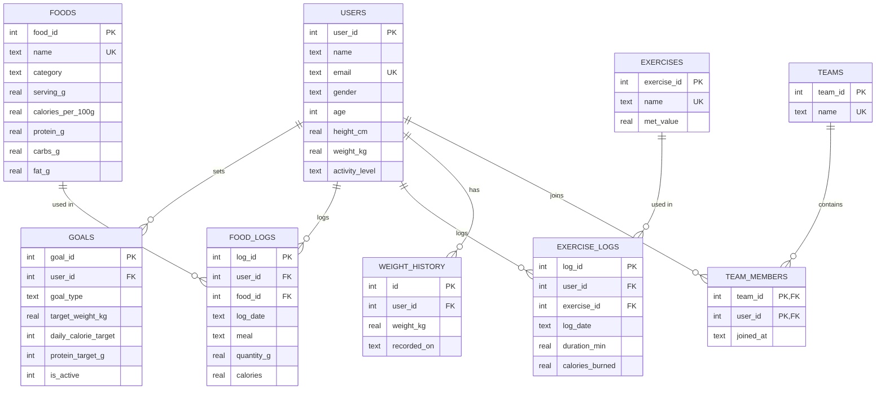

# Calorie Tracking System
**Python · SQLite · SQL · DBMS**

A database-driven health tracker where a person — or a group of people — logs daily food and exercise, sets a fitness goal (lose / maintain / gain weight), and gets personalised recommendations to reach it.

---

## Features
- Register users; BMI, maintenance calories (BMR × activity) and daily calorie + protein targets calculated automatically
- Log food (38 common Indian foods preloaded) and exercise (12 activities) by date and meal
- Nutrition and calories burned are calculated **inside the database by triggers**
- Daily summary: calories in / burned / net, protein-carbs-fat, status (on track / over / under)
- **Recommendations**: foods that fit your remaining calories, how long to exercise to burn extra calories, protein gaps, macro balance, skipped meals, weekly trend and projected weight change, estimated weeks to target weight
- **Groups (teams)**: create or join a team, 7-day leaderboard (days logged, days on track, active minutes)
- Charts: weekly calories vs target, weight progress, team leaderboard (saved as PNG)
- Weight history recorded automatically every time weight changes

---

## Project phases

### Phase 1 — Requirements & ER design
Identify entities and relationships:
- A **user** sets many **goals** (only one active), logs many **food logs** and **exercise logs**, has a **weight history**, and joins many **teams**.
- **Foods** and **exercises** are master tables; logs reference them.



### Phase 2 — Normalized schema & constraints (`schema.sql`)
- 9 tables in **3NF**: nutrition values live once in `foods`; logs store only the food id + quantity (the calculated calories are a deliberate, trigger-maintained snapshot so old logs don't change if food data is edited).
- `team_members` resolves the many-to-many between users and teams with a composite primary key.
- Constraints: `PRIMARY KEY`, `FOREIGN KEY … ON DELETE CASCADE`, `UNIQUE` (email, food name, team name), `NOT NULL`, `CHECK` (age range, gender, meal type, goal type, quantity > 0, etc.), `DEFAULT` dates.
- Indexes on `(user_id, log_date)` for fast daily lookups.

### Phase 3 — Triggers & views (`schema.sql`)
| Trigger | What it does |
|---|---|
| `trg_food_no_future` | Blocks logging food for a future date (`RAISE(ABORT)`) |
| `trg_food_log_nutrition` | Calculates calories, protein, carbs, fat on insert |
| `trg_food_log_qty_update` | Recalculates them when quantity is edited |
| `trg_exercise_calories` | Calories burned = MET × weight × hours |
| `trg_user_initial_weight` | Saves starting weight on registration |
| `trg_user_weight_change` | Saves every weight change to history |
| `trg_single_active_goal` | New goal automatically deactivates old ones |

| View | What it shows |
|---|---|
| `v_daily_intake` | Food totals per user per day |
| `v_daily_burn` | Exercise totals per user per day |
| `v_daily_summary` | Intake, burn, net, target, remaining, status (uses CTE + `UNION` + `LEFT JOIN`) |
| `v_team_weekly` | Team leaderboard for the last 7 days |

### Phase 4 — Python data layer + app (`db.py`, `app.py`)
- `db.py` holds every SQL query (parameterised, so safe from SQL injection) and creates/seeds the database.
- `app.py` is the terminal menu: register, log food, log exercise, summaries, goals, weight, teams, charts.

### Phase 5 — Goal calculation & recommendations (`calculator.py`, `recommend.py`)
- **BMR** (Mifflin-St Jeor): `10×kg + 6.25×cm − 5×age + 5` (men) / `− 161` (women)
- **Maintenance (TDEE)** = BMR × activity factor (1.2 – 1.9)
- **Daily target** = TDEE − 500 (lose) / + 0 (maintain) / + 300 (gain), never below 1200 (F) / 1500 (M)
- **Protein target** = 1.6 / 1.2 / 1.8 g per kg body weight
- **Rules** in `recommend.py`:
  1. Calories left → suggests foods that fit (lean high-protein for lose/maintain, calorie-dense for gain)
  2. Calories over → minutes of walking / cycling / skipping needed to burn the excess
  3. Protein short → protein-rich foods
  4. Fat > 35 % or carbs > 60 % of calories → balance warning
  5. Skipped breakfast / no exercise → reminder
  6. Weekly trend → projected kg/week (7700 kcal ≈ 1 kg), checks it matches the goal direction, warns if losing > 1 kg/week, estimates weeks to target weight

### Phase 6 — Reports, groups, charts, testing (`charts.py`, `sample_queries.sql`)
- Weekly report table, team leaderboard, three matplotlib charts saved in `charts/`
- `sample_queries.sql` — 12 queries for viva/interviews: INNER/LEFT JOIN, GROUP BY + HAVING, subqueries, window function, view usage, trigger and constraint demos

---

## How to run
```bash
pip install -r requirements.txt

# Web app (opens in your browser)
streamlit run streamlit_app.py

# or the terminal menu
python app.py
```
Both use the same database, so data entered in one shows up in the other.
On a fresh database, click **Load demo data** to see the app filled with sample users, a week of logs and a team.

### Web app pages
- **Sidebar**: pick or register a user, see BMI / maintenance calories, set or change goal
- **Dashboard**: calories in / burned / net / remaining, protein, progress bar, macro chart, recommendations, today's food and exercise log
- **Log**: forms to add food (by servings) and exercise
- **Weekly**: 7-day chart vs target, days on track, daily table
- **Team**: create or join a team, leaderboard and chart
- **Weight**: update weight, weight-progress chart vs target
The database file `calorie_tracker.db` is created automatically on first run, with foods and exercises preloaded.

To try the SQL queries (needs the `sqlite3` command-line tool):
```bash
sqlite3 calorie_tracker.db ".read sample_queries.sql"
```
Or open `calorie_tracker.db` in **DB Browser for SQLite** and paste queries from the file.

## Typical flow
1. Register → choose goal (e.g. lose, target 72 kg) → targets are calculated
2. Log breakfast, lunch, dinner and any exercise through the day
3. Option **3** shows today's summary and recommendations
4. Create a team (option **7**) and have friends join it → compare on the leaderboard
5. Option **8** saves charts to the `charts/` folder

## Files
| File | Purpose |
|---|---|
| `schema.sql` | Tables, constraints, indexes, triggers, views |
| `seed_data.py` | Foods (per 100 g) and exercises (MET values) |
| `db.py` | Connection, setup, all queries |
| `calculator.py` | BMI, BMR, TDEE, calorie and protein targets |
| `recommend.py` | Recommendation engine |
| `charts.py` | Matplotlib charts |
| `streamlit_app.py` | Web frontend (Streamlit) |
| `demo.py` | Sample users, team and a week of logs ("Load demo data" button) |
| `app.py` | Terminal menu |
| `sample_queries.sql` | SQL showcase for viva |

## Possible extensions
- Deploy the web app on Streamlit Community Cloud
- Barcode / custom food entry
- Weekly email summary
- Migrate to MySQL/PostgreSQL (schema is portable with small changes)

> Nutrition values are approximate averages; this project is for learning, not medical advice.
